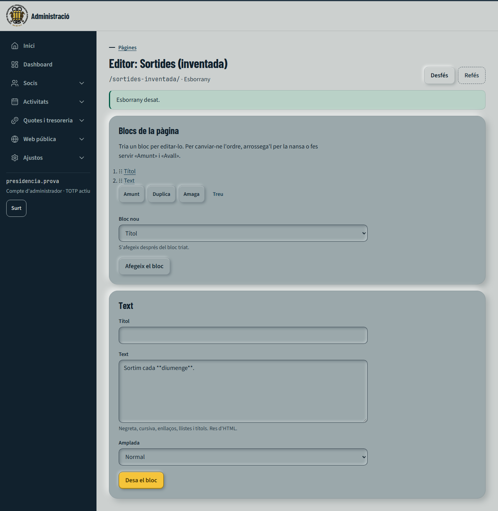
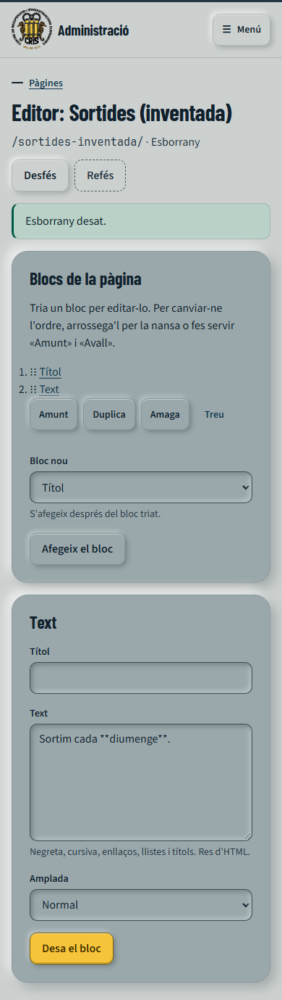
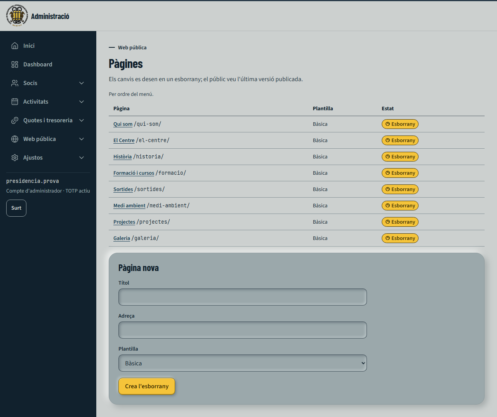
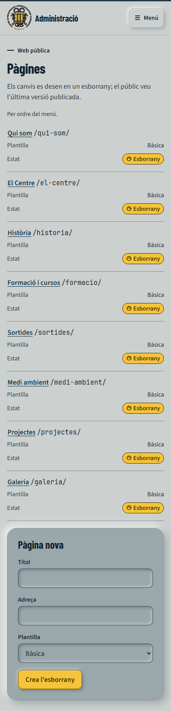

# T-M07-06a · Editor de la web: pàgines, blocs, arrossegar i desfer

| Data i hora (Europa/Madrid) | Commit | Proves | CI |
|---|---|---|---|
| 27/11/2026 22:59 | (vegeu la PR) | 46 noves i 1 e2e | [A comprovar] |

**En tres línies:** a l'administració hi ha ara la llista de pàgines de la web i un editor per a cada una. S'hi afegeixen blocs, s'omplen amb un formulari, es canvien d'ordre arrossegant-los o amb «Amunt» i «Avall», es dupliquen, s'amaguen i es treuen, i tot es pot desfer i refer. Cada canvi es desa a l'esborrany; el públic continua veient l'última versió publicada.

## Què s'ha fet
- `apps/website/editor.py`: les operacions sobre la llista de blocs i l'historial de desfer i refer a la sessió.
- `apps/website/editor_forms.py`: el formulari de cada tipus de bloc, fet a partir de l'esquema del catàleg.
- `apps/website/editor_views.py` i rutes `/gestio/web/pagines/`: la llista, crear una pàgina i l'editor.
- `templates/website/admin/pages.html` i `page_editor.html`; `static/js/editor-web.js` (SortableJS i Ctrl+Z).
- `docs/estat/M07.md`, P-682 a `pendents.md` i al tauler, T-DX-160 a `DX.md`, `STANDALONE` de la prova de navegació i el mapa d'e2e.

## Decisions i perquè
- **Tot passa pel servidor:** cada acció és un formulari; sense JS, els botons fan el mateix que arrossegar i que Ctrl+Z. El servidor torna a demanar WP1 i valida l'esquema (CA-M07-23).
- **Desfer i refer dins la sessió:** l'historial (fins a 50 passos) és a la sessió del navegador, per pàgina. Dins d'un camp de text, Ctrl+Z és el del navegador.
- **Seccions (P-682, reversible):** encara no es poden afegir des de l'editor; una que ja hi sigui es mou i se'n canvien les variants, sense tocar els blocs de dins.
- **Fotos:** el formulari només ofereix les de la biblioteca que es poden publicar; el selector amb dues pestanyes és la T-M07-30.
- **Departament:** pel número fins que hi hagi un selector.
- **Menú:** les pantalles són a `STANDALONE` fins que DISSENY hi posi l'entrada (T-DX-160).

## Com se sap que funciona
- Cada acció torna una llista nova i no toca l'original; les que no tenen sentit (moure el primer amunt, un tipus inventat, un ordre amb repetits) es rebutgen.
- Crear una pàgina, afegir i omplir un bloc, duplicar, amagar, desfer dues vegades i refer deixa l'esborrany com toca; editar no publica cap versió.
- Un bloc fora d'esquema torna l'error i l'esborrany no canvia (CA-M07-23); sense WP1, «no trobat».
- El formulari de cada un dels 26 tipus torna el mateix bloc.
- Al navegador: el President crea una pàgina, afegeix dos blocs, n'omple un, l'arrossega per la nansa, el mou amb «Avall», l'amaga i ho desfà amb Ctrl+Z.

## Evidències
- Sortida de proves · executada el 27/11/2026 en local (PostgreSQL 16):
  ```
  $ pytest -q apps/website apps/accounts/tests/test_navigation_subpages.py apps/accounts/tests/test_pages.py apps/core/tests/test_member_templates_no_review_marks.py -m "not e2e"
  672 passed
  $ pytest -m e2e apps/core/tests/e2e/test_editor_web.py
  1 passed
  ```
- Captures (mirades):
  
  
  
  

## Termes nous
- **Nansa**: la marca d'on s'agafa un element per arrossegar-lo.
