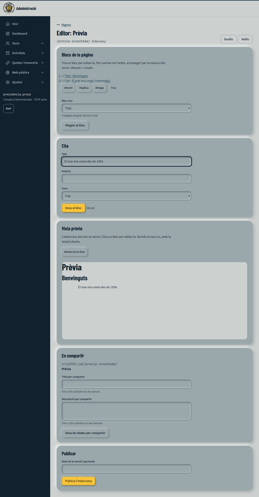
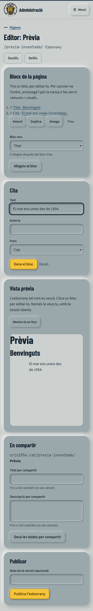

# T-M07-06b · Editor de la web: vista prèvia en viu, desat automàtic i avís d'edició simultània

| Data i hora (Europa/Madrid) | Commit | Proves | CI |
|---|---|---|---|
| 27/11/2026 23:21 | (vegeu la PR) | 10 noves i 1 e2e | [A comprovar] |

**En tres línies:** l'editor mostra ara la pàgina tal com quedarà, i clicant un bloc a la vista prèvia es tria per editar-lo. El que s'escriu es desa sol cada pocs segons i, si una altra persona té la mateixa pàgina oberta, surt un avís. Des del mateix editor es preparen les dades per compartir, es publica l'esborrany i es torna a una versió anterior.

## Què s'ha fet
- `apps/website/editor_live.py` i rutes: vista prèvia, desat automàtic i presència, compartir, publicar i tornar a una versió.
- `apps/website/render.py`: a la vista prèvia, cada bloc porta el seu número (`data-bloc`).
- `apps/website/models.py` i migració `website/0013`: `PageEditing` (qui té l'editor obert i quan); `editor.touch` i `editor.fingerprint`; `pages.publish_draft`.
- `templates/website/admin/page_preview.html` (provisional fins a la T-M07-05), seccions noves a `page_editor.html`; `static/js/previa-web.js` i el desat automàtic a `editor-web.js`.
- `docs/estat/M07.md` i T-DX-161 a `DX.md`; `STANDALONE` de la prova de navegació.

## Decisions i perquè
- **Vista prèvia només aquí:** demana sessió i WP1 i només es pot posar dins d'una pàgina del mateix origen (RN-M07-23).
- **El desat automàtic no esborra feina d'altri (CA-M07-32):** cada formulari porta l'empremta del bloc tal com era en obrir-lo; si una altra persona l'ha canviat o mogut, el servidor respon 409 i no desa res.
- **Avís d'edició simultània:** el servidor apunta qui té l'editor obert; qui no ha donat senyals en tres desats ja no hi surt. No bloqueja res.
- **Tornar a una versió:** publica una còpia (RN-M07-03) i deixa l'esborrany igual; el que hi havia abans es pot recuperar amb «Desfés».
- **Fotos de la vista prèvia:** només les que ja se serveixen; les noves de l'esborrany surten sense foto fins que hi hagi la vista de fotos amb sessió (torn del nucli).
- **Mides de mòbil, tauleta i escriptori:** pendents del Probador (T-DX-161); ara hi ha el canvi de clar a fosc.

## Com se sap que funciona
- RN-M07-23: la vista prèvia surt amb WP1 i `SAMEORIGIN`, sense els blocs amagats; sense WP1, «no trobat»; sense sessió, a entrar.
- CA-M07-32: la segona persona veu el nom de la primera; passats uns minuts sense senyals, ja no.
- CA-M07-32: un desat automàtic amb una empremta antiga (un bloc afegit al davant per una altra persona) respon 409 i l'esborrany no canvia; un bloc fora d'esquema, 400.
- CA-M07-20: publicar, tornar a publicar i tornar a la versió 1 deixen tres entrades al registre amb la versió anterior.
- RN-M07-13: un títol per compartir de 70 caràcters es desa amb l'avís.
- Al navegador: clicar la cita a la vista prèvia la tria, escriure-hi la desa sola («Desat.») i la vista prèvia es refresca.

## Evidències
- Sortida de proves · executada el 27/11/2026 en local (PostgreSQL 16):
  ```
  $ pytest -q apps/website apps/accounts/tests/test_navigation_subpages.py apps/accounts/tests/test_pages.py apps/core/tests/test_member_templates_no_review_marks.py -m "not e2e"
  687 passed
  $ pytest -m e2e apps/core/tests/e2e/test_editor_web.py
  2 passed
  ```
- Captures (mirades):
  
  

## Termes nous
- **Empremta** (en anglès: *fingerprint*): un resum curt d'un bloc que canvia si el bloc canvia.
