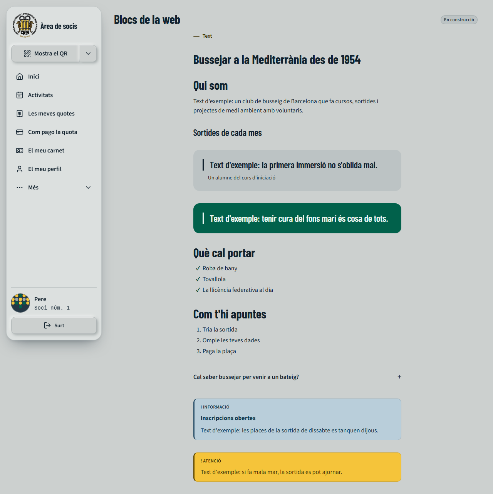
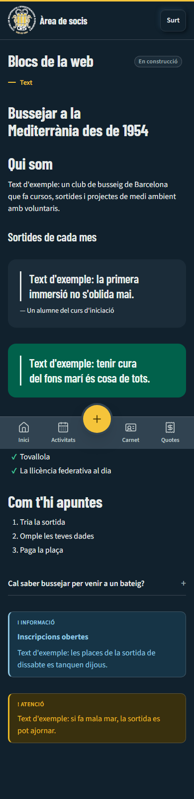

# T-M07-19a · Blocs de la web pública: grup Text

| Data i hora (Europa/Madrid) | Commit | Proves | CI |
|---|---|---|---|
| 27/11/2026 22:49 | 570ef7e0 | 2 noves (i les comunes de §16) | [A comprovar] |

**En tres línies:** és la primera part de la T-M07-19, el catàleg de blocs de la decisió 106. Fa els sis blocs de text (títol, text, cita, llista, pregunta desplegable i avís destacat) amb les plantilles que el renderitzador del pilot carrega, la peça al sistema de disseny i una pantalla de catàleg que els mostra amb contingut d'exemple. Qui edita només tria variants tancades.

## Què s'ha fet
- `templates/website/blocs/heading.html`, `text.html`, `quote.html`, `list.html`, `disclosure.html` i `callout.html`, amb els noms de camp de l'esquema de l'addenda de la 106.
- `static/css/blocs-web.css`: la columna de la pàgina (`blocs-pagina`, amb línies amb nom per a les amplades `normal`, `wide` i `full`), els fons tancats (`soft`, `marine` i `accent`, que pinta l'accent de la pàgina) i el text en Markdown restringit (`bloc-prosa`).
- `static/css/tokens.css`: `avis-info`, que l'addenda fa servir per a l'avís destacat i no existia.
- `docs/design-system.md` §6.27: el contracte amb el renderitzador i la peça.
- Pantalla de catàleg `/en-construccio/blocs-web/` (`apps/previews`), que pinta cada bloc amb la seva plantilla real.
- Prova `apps/previews/tests/test_blocs_web.py`: el text cru s'escapa a tots sis blocs (cap `<script>`) i les variants donen classes tancades.

## Decisions i perquè
- **Contracte acordat amb el pilot el 27/11:** la plantilla rep `block` i `page`; els blocs amagats no hi arriben; els camps «md» arriben convertits amb el mateix nom, i si arriben crus, Django els escapa. Així la plantilla és segura encara que el renderitzador s'equivoqui.
- **Codis de variant en anglès**, com els camps de l'esquema.
- **Una graella amb mides `min()`:** al primer intent, cada títol s'amplava diferent perquè els `ch` es calculaven amb la seva mida de lletra; al segon, la columna de text sortia estreta perquè Chromium reparteix l'espai a les columnes `1fr`. Ara la mesura es calcula al contenidor.
- **L'avís destacat diu el to en text** («Informació» o «Atenció»): el color sol no informa (§6.3).
- **Pantalla de catàleg a `apps/previews`:** el pilot no toca `templates/website/blocs/` (llevat de `_provisional/`) i jo no toco `apps/website`.

## Com se sap que funciona
- Passen les proves de `apps/previews` (81) i les de contrast dels tokens. L'e2e comuna de §16 obre la pantalla i en fa les captures.

## Comprovació §15.5
- **B:** cap animació; la pregunta s'obre amb clic o teclat (`details`), amb una àrea de 44 px.
- **C:** vores amb `--c-linia` (transparència); radis de tokens.
- **D:** cap insígnia decorativa; títols amb `balance` i text amb `pretty`; contrast de l'avís amb els tokens d'estat, comprovat per `test_tokens_color.py`.
- **Tokens:** cap color ni mida fora de `tokens.css`; cap `style=`.
- **Captures mirades** a 1280, 1024, 390 i 320 px, en clar i en fosc. La barra inferior del soci surt a mitja pàgina a 390 px perquè la captura és de la pàgina sencera; a la pantalla es queda a baix.

## Queda
- Els grups Mitjans, Disposició, Acció i Dades del club (T-M07-19b a e). El bloc `spacer` necessitarà tokens d'espai (avís del pilot).

## Evidències
- El catàleg del grup Text a 1280 px. `captures/2026-11-27_2249_T-M07-19a_blocs-text-1280.png`

  

  *27/11/2026 22:49 (Europa/Madrid) · local, prova e2e, dades inventades · commit 570ef7e0*

- El mateix a 390 px, en fosc. `captures/2026-11-27_2249_T-M07-19a_blocs-text-390-fosc.png`

  

  *27/11/2026 22:49 (Europa/Madrid) · local, prova e2e, dades inventades · commit 570ef7e0*
