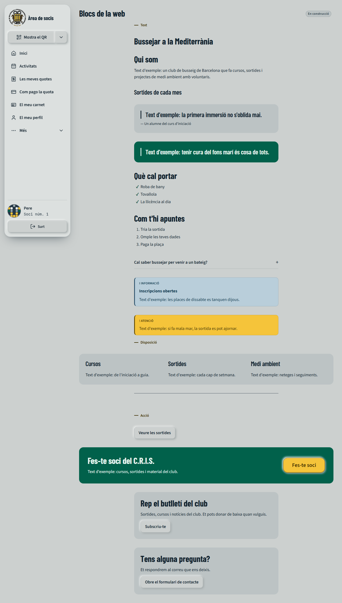
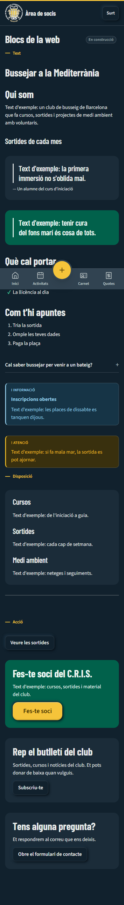

# T-M07-19b · Blocs de la web pública: grups Disposició i Acció

| Data i hora (Europa/Madrid) | Commit | Proves | CI |
|---|---|---|---|
| 27/11/2026 23:20 | 9f51019e | 2 noves | [A comprovar] |

**En tres línies:** segona part del catàleg de blocs de la decisió 106 (T-M07-19). Fa la secció d'1 a 3 columnes, el separador i l'espai, i els blocs d'acció: el botó, la crida «Fes-te soci», el butlletí i el contacte. Tots surten al catàleg `/en-construccio/blocs-web/`.

## Què s'ha fet
- `templates/website/blocs/section.html`, `divider.html`, `spacer.html`, `button.html`, `join_cta.html`, `newsletter.html` i `contact_form.html`.
- `static/css/blocs-web.css`: les columnes de la secció, els espais amb tokens (`--e-5`, `--e-7` i `--e-8`; el pilot havia avisat que no n'hi havia) i la crida de soci.
- `docs/design-system.md` §6.27: els dos grups.
- El catàleg, amb els dos grups nous, i `apps/previews/tests/test_blocs_web.py`, amb dues proves més: la secció pinta cada bloc de dins amb la seva plantilla i escapat, i el botó escapa l'etiqueta i només és principal amb `primary`.

## Decisions i perquè
- **La secció accepta la plantilla ja triada** (`template` a cada bloc de dins): el renderitzador del pilot tria entre la definitiva i la provisional, i la secció no ha de saber quines falten.
- **El butlletí i el contacte són crides, no formularis incrustats:** el consentiment, la doble confirmació i els límits ja són a `/butlleti/` i `/contacte/`, i no es dupliquen. Es pot canviar si el pilot vol el formulari a la mateixa pàgina.
- **Els botons no hereten el color** dins d'un fons marí o d'accent: al primer intent, «Fes-te soci» sortia amb el text clar sobre el daurat.

## Com se sap que funciona
- Passen les proves dels blocs i les comunes de §16 per al catàleg.

## Comprovació §15.5
- **B:** cap moviment nou (el premut del botó ja era del component). Objectius de 44 px.
- **D:** al catàleg hi ha un botó principal, el de la crida de soci; en una pàgina real, el revisor avisa si n'hi ha més d'un.
- **Tokens:** cap color ni mida fora de `tokens.css`; cap `style=`.
- **Captures mirades** a 1280, 1024, 390 i 320 px, en clar i en fosc.

## Queda
- Mitjans (amb les fotos de la T-M07-31) i Dades del club.

## Evidències
- El catàleg a 1280 px. `captures/2026-11-27_2320_T-M07-19b_blocs-1280.png`

  

  *27/11/2026 23:20 (Europa/Madrid) · local, prova e2e, dades inventades · commit 9f51019e*

- A 390 px, en fosc. `captures/2026-11-27_2320_T-M07-19b_blocs-390-fosc.png`

  

  *27/11/2026 23:20 (Europa/Madrid) · local, prova e2e, dades inventades · commit 9f51019e*
