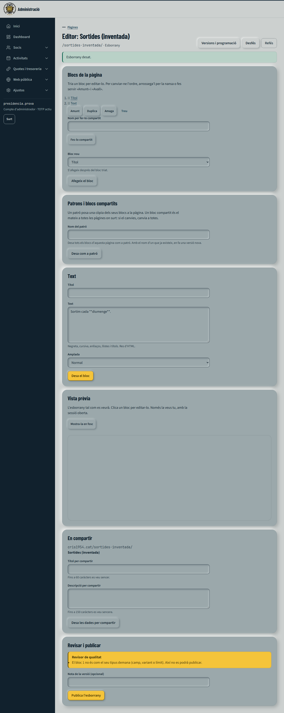
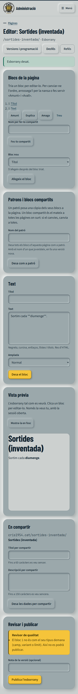

# T-M07-20a · Patrons i blocs compartits

| Data i hora (Europa/Madrid) | Commit | Proves | CI |
|---|---|---|---|
| 28/11/2026 00:43 | (vegeu la PR) | 15 noves | [A comprovar] |

**En tres línies:** a l'editor es pot desar una pàgina com a patró i inserir-ne una còpia a una altra pàgina. També es pot fer «compartit» un bloc: llavors surt igual a totes les pàgines on s'insereix i, si es canvia, canvia a totes. Patrons i blocs compartits tenen versions que no es poden modificar, com les pàgines.

## Què s'ha fet
- `apps/website/models.py` i migració `website/0022` (depèn de la `0018`): `Pattern`, `PatternVersion`, `SharedBlock` i `SharedBlockVersion`; les versions només admeten INSERT, també a la base de dades.
- `apps/website/library.py`: desar (amb registre), el contingut vigent i `resolve`, que posa el contingut dels compartits a la pàgina abans de pintar-la o publicar-la.
- `apps/website/library_views.py` i la secció «Patrons i blocs compartits» de l'editor.
- Catàleg: el tipus `shared` per a la referència (P-688). Renderitzador, publicació i fotos de la web el tenen en compte.
- P-688 a `pendents.md` i al tauler; `docs/estat/M07.md`.

## Decisions i perquè
- **Patró = còpia:** una versió nova d'un patró no canvia les pàgines on ja s'havia inserit.
- **Bloc compartit = referència (P-688):** la pàgina desa `{"kind": "shared", "shared": N}`; amagar-lo és de cada pàgina. Canviar-lo des de l'editor fa una versió nova amb empremta (409 si algú l'ha canviat abans).
- **Publicar** valida el contingut dels compartits i les seves fotos; una foto de dins d'un compartit d'una pàgina publicada se serveix.
- **Permisos:** WP1 fa de WP9 i WP10 fins al torn del nucli.

## Com se sap que funciona
- Versions 1 i 2 d'un patró, al registre; no es poden modificar ni esborrar, tampoc amb SQL.
- Un patró sense nom, amb un nom massa llarg o amb un bloc fora d'esquema es rebutja; un compartit no pot ser una referència ni repetir nom.
- Inserir un patró en posa una còpia; fer compartit un bloc i inserir-lo a una altra pàgina, i canviar-lo, canvia les dues.
- En pintar, es respecta l'amagat de cada pàgina, dins de seccions també, i un compartit que no hi és no pinta res.
- Publicar demana una foto publicable dins del compartit i, després, la serveix.
- Accions sense sentit i sense WP1, rebutjades.

## Evidències
- Sortida de proves · executada el 28/11/2026 en local (PostgreSQL 16):
  ```
  $ pytest -q apps/website apps/accounts/tests/test_navigation_subpages.py -m "not e2e"
  403 passed, 1 xfailed
  $ pytest -m e2e apps/core/tests/e2e/test_editor_web.py
  4 passed
  ```
- Captures (mirades):
  
  
