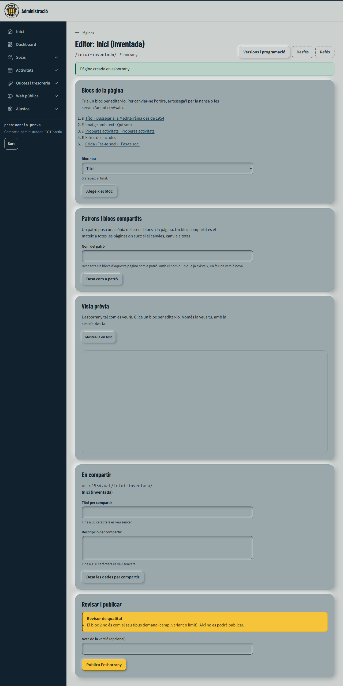
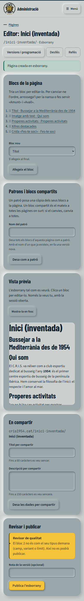

# T-M07-20b · Plantilles de pàgina amb contingut d'exemple

| Data i hora (Europa/Madrid) | Commit | Proves | CI |
|---|---|---|---|
| 28/11/2026 00:49 | (vegeu la PR) | 10 noves i 1 e2e | [A comprovar] |

**En tres línies:** en crear una pàgina es tria una de les sis plantilles (Portada, Secció, Article, Projecte, Galeria i Captació) i l'esborrany ja comença amb blocs d'exemple fets amb els textos de la web actual del club. Les fotos d'exemple són les de la biblioteca; en local, les dades de mostra hi carreguen les fotos reals del club (decisió 107).

## Què s'ha fet
- `apps/website/models.py` i migració `website/0023`: les sis plantilles; les pàgines amb una plantilla antiga passen a la més propera (P-750).
- `apps/website/page_templates.py`: el contingut d'exemple de cada plantilla.
- `apps/website/editor_views.py`: una pàgina nova comença amb l'exemple de la seva plantilla.
- `apps/website/demo_data.py`: `seed_demo_data` carrega les fotos de `static/img/web/cris1954/` amb l'autor, el permís, el text alternatiu i si hi surten persones de `fotos.yml` (sense el directori, cap).
- P-750 a `pendents.md` i al tauler; `docs/estat/M07.md`.

## Decisions i perquè
- **Contingut d'exemple al codi**, com la llista de plantilles: és un punt de partida que es canvia tot a l'editor; els textos surten de `docs/web/contingut-cris1954/` i cap dada nova del club (les xifres del Projecte són «xifra d'exemple»).
- **Fotos:** les primeres de la biblioteca que es poden publicar; si no n'hi ha, el bloc queda sense foto i el revisor ho avisa.
- **`fotos.yml` sense PyYAML:** un lector del format pla del fitxer (marcat com a drecera) per no afegir cap dependència.
- **Les pàgines inicials reals** (mateix menú que la web actual) són una tasca a part (T-M07-37).

## Com se sap que funciona
- La llista és la de l'addenda; cada exemple és un esborrany vàlid i, amb fotos a la biblioteca, es pot publicar.
- Una pàgina nova de Captació comença amb el seu exemple.
- La migració passa Bàsica i Activitats a Secció i Notícies a Article, i torna enrere.
- Les fotos de mostra es carreguen amb els seus detalls i es poden publicar; un fitxer que falta o un GIF no es carreguen.
- Al navegador: una pàgina nova amb la plantilla Portada obre l'editor amb els cinc blocs d'exemple.

## Evidències
- Sortida de proves · executada el 28/11/2026 en local (PostgreSQL 16):
  ```
  $ pytest -q apps/website apps/accounts/tests/test_navigation_subpages.py -m "not e2e"
  413 passed, 1 xfailed
  $ pytest -m e2e apps/core/tests/e2e/test_editor_web.py
  5 passed
  ```
- Captures (mirades):
  
  

## Revisió (28/11/2026)
- El camí de tornada de la migració `website/0023` és **amb pèrdua**: Secció, Projecte, Galeria i Captació tornen totes a Bàsica, i Article a Notícies; no es pot saber quina d'elles era Activitats. No toca els blocs ni les versions.
- Desar les fotos de mostra demana WP3 (revisió de la 23): la llavor les carrega amb el compte d'administrador.
