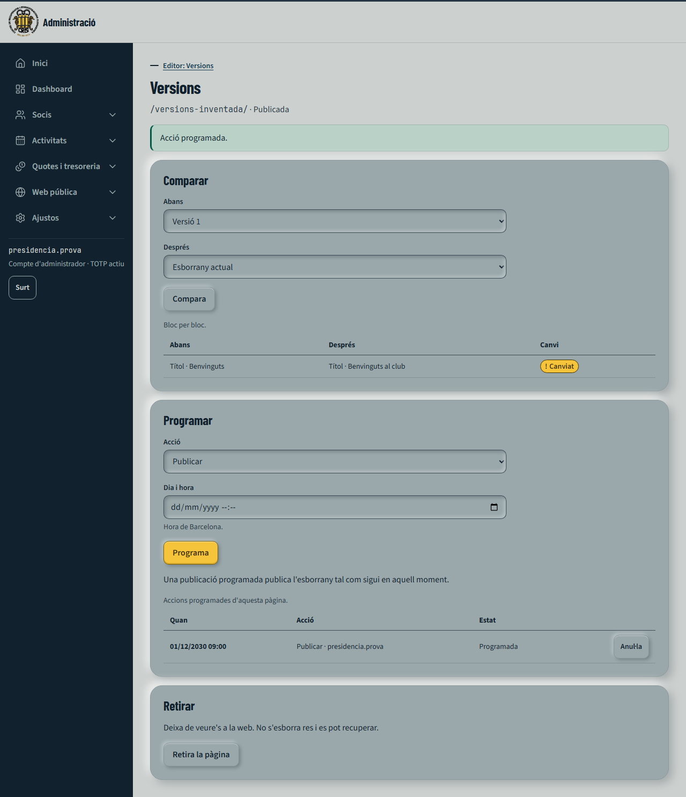
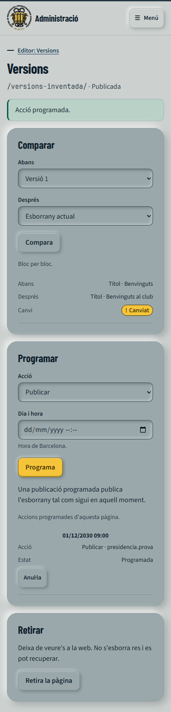

# T-M07-22 · Versions comparables, publicació programada i recuperar una pàgina retirada

| Data i hora (Europa/Madrid) | Commit | Proves | CI |
|---|---|---|---|
| 27/11/2026 23:43 | (vegeu la PR) | 12 noves i 1 e2e | [A comprovar] |

**En tres línies:** cada pàgina té ara una pantalla de versions. S'hi comparen dues versions, o una amb l'esborrany, bloc per bloc; s'hi programa una publicació o una retirada per a un dia i una hora, que es pot anul·lar fins que arriba; i s'hi retira o es recupera la pàgina. Res no s'esborra mai.

## Què s'ha fet
- `apps/website/schedule.py`: comparar, programar, anul·lar i executar les programades.
- `apps/website/pages.py`: `retire_page` i `recover_page`, amb registre.
- `apps/website/models.py` i migració `website/0016` (depèn de la `0013_page_editing`): `ScheduledAction`.
- `apps/website/tasks.py`: `website.run_scheduled_actions`, cada minut.
- `apps/website/versions_views.py`, rutes i `templates/website/admin/page_versions.html`; enllaços des de l'editor i, per a les retirades, des de la llista.
- P-684 a `pendents.md` i al tauler; `docs/estat/M07.md`; mapa d'e2e i `STANDALONE`.

## Decisions i perquè
- **Una sola vegada (CA-M07-26):** la cua bloqueja la fila i només fa les que encara són «programada»; dues execucions alhora no la fan dues vegades.
- **A nom de qui la va programar:** la publicació passa pel mateix servei, amb el seu compte; si ja no té permís o l'esborrany no es pot publicar, queda «no s'ha pogut fer» amb el motiu i no es publica res.
- **Què es publica (P-684, reversible):** l'esborrany tal com és quan arriba l'hora; la pantalla ho diu.
- **Comparar:** bloc per bloc amb l'empremta de cada bloc; un bloc que canvia de lloc surt com a tret i afegit.
- **Recuperar (CA-M07-33):** torna a esborrany amb el contingut de l'última versió; el públic no la veu fins que es publica.

## Com se sap que funciona
- RN-M07-16: igual, canviat, afegit i tret, bloc per bloc.
- CA-M07-26: abans de l'hora no es fa; després, una vegada i no dues; el registre té el compte de qui la va programar; una d'anul·lada no fa res i no es pot tornar a anul·lar.
- Una programada que ja no es pot fer (esborrany a mig fer, retirar una pàgina no publicada, sense permís) queda «no s'ha pogut fer» amb el motiu.
- No es pot programar el passat ni una acció inventada.
- CA-M07-33: retirar i recuperar, al registre; la pàgina i les versions es queden.
- Sense WP1, «no trobat».
- Al navegador: comparar, programar, anul·lar, retirar i recuperar.

## Evidències
- Sortida de proves · executada el 27/11/2026 en local (PostgreSQL 16):
  ```
  $ pytest -q apps/website apps/accounts/tests/test_navigation_subpages.py apps/accounts/tests/test_pages.py apps/core/tests/test_member_templates_no_review_marks.py -m "not e2e"
  705 passed
  $ pytest -m e2e apps/core/tests/e2e/test_editor_web.py
  3 passed
  ```
- Captures (mirades):
  
  

## Termes nous
- **Acció programada**: una publicació o una retirada que la plataforma farà sola a l'hora triada.
