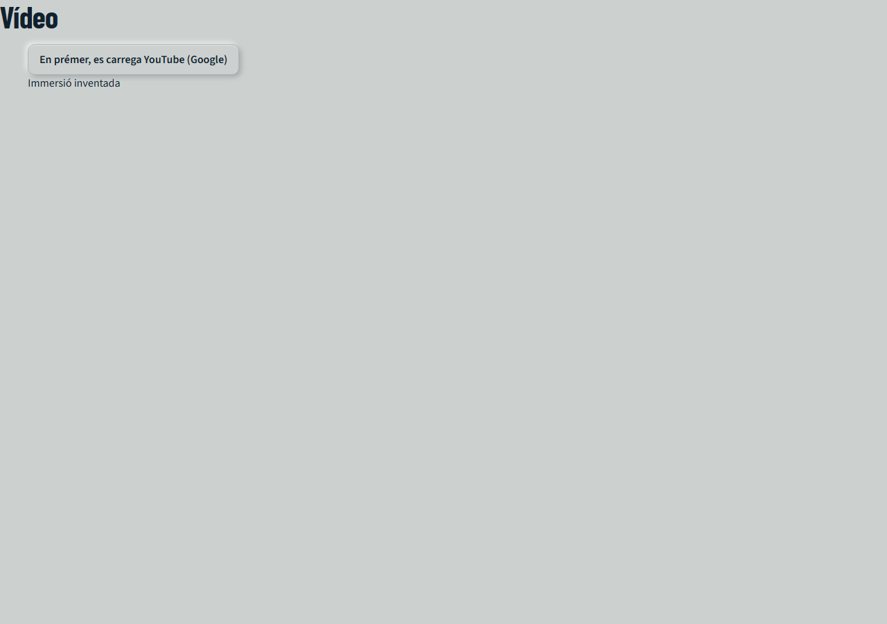
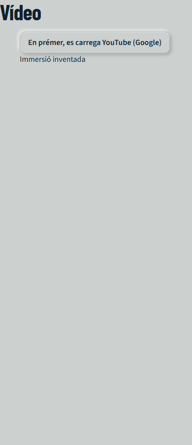

# T-M07-23 · Bloc de vídeo: YouTube amb clic per carregar i vídeo propi

| Data i hora (Europa/Madrid) | Commit | Proves | CI |
|---|---|---|---|
| 28/11/2026 00:34 | (vegeu la PR) | 13 noves i 1 e2e | [A comprovar] |

**En tres línies:** el bloc de vídeo ja es pinta. Amb YouTube, el visitant veu la miniatura (desada al nostre servidor) i l'avís «En prémer, es carrega YouTube (Google)», i fins que no prem no es demana res a Google; llavors es carrega des de youtube-nocookie.com. També hi pot haver un vídeo propi, només MP4. Tot comença apagat.

## Què s'ha fet
- `apps/website/video.py`: la miniatura baixada pel servidor en desar el bloc (fora del bloqueig de la pàgina) i l'adreça de `youtube-nocookie.com` i l'avís per a la plantilla.
- `apps/website/media.py`: `store_image` (la miniatura, amb la validació i la neteja d'una pujada) i `upload_video` (només MP4 pel contingut, amb la mida màxima).
- `apps/website/render.py`, plantilla provisional `video.html` i `static/js/video-web.js` (l'iframe només en prémer).
- Migració `website/0018` (depèn de la `0016`): `website.youtube_notice` i `website.video_upload_enabled` (apagat).
- P-685 i P-687 a `pendents.md` i al tauler; `docs/estat/M07.md`; mapa d'e2e.

## Decisions i perquè
- **L'avís és un ajust** (P-574): el text el valida la junta i s'ha de poder canviar sense codi.
- **Miniatura (P-685, irreversible → conservadora):** es desa marcada «s'hi veuen persones» i sense consentiment; no es pot publicar fins que algú amb WP3 la revisa.
- **Vídeo propi (P-610, P-687):** només MP4 comprovat pel contingut; la pujada queda apagada perquè encara no se'n poden treure les metadades (el lloc). Es pinta, com les fotos, si es pot publicar i amb les imatges públiques enceses.
- **La baixada es fa abans de bloquejar la pàgina:** cap espera a la xarxa amb el bloqueig posat.

## Com se sap que funciona
- CA-M07-25, al navegador: abans del clic, cap petició a cap domini de Google; després, només a `youtube-nocookie.com` (amb una resposta falsa a la prova). Amb l'ajust apagat, el bloc no surt.
- La miniatura es baixa una sola vegada, només amb l'ajust encès, i un contingut que no és una imatge no es desa.
- La baixada només va a l'adreça de la miniatura; sense xarxa, el bloc es desa igual.
- Vídeo propi: apagat d'inici, un fitxer que no és MP4 o massa gran es rebutja, i un vídeo sense autor ni permís no es publica.

## Evidències
- Sortida de proves · executada el 28/11/2026 en local (PostgreSQL 16):
  ```
  $ pytest -q apps/website -m "not e2e"
  388 passed, 1 xfailed
  $ pytest -m e2e apps/core/tests/e2e/test_editor_web.py
  4 passed
  ```
- Captures (mirades):
  
  
