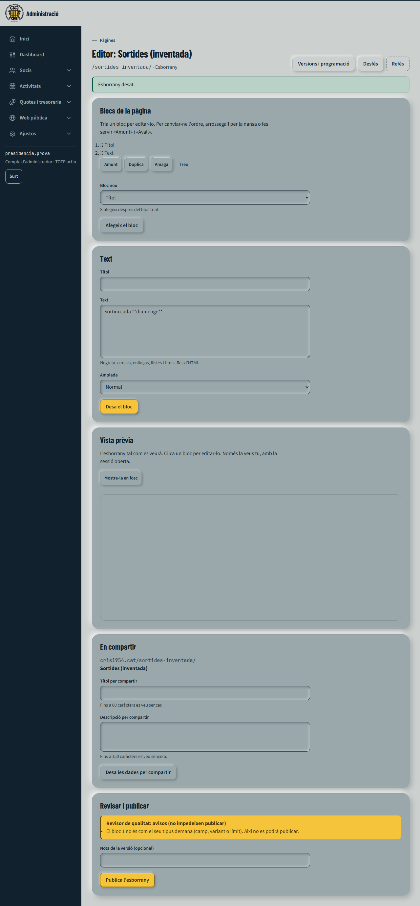
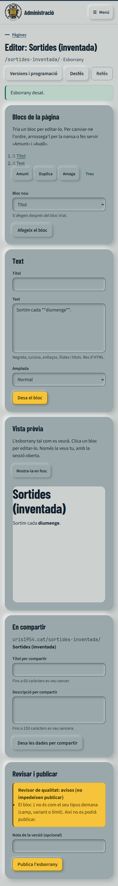

# T-M07-25 · Revisor de qualitat abans de publicar

| Data i hora (Europa/Madrid) | Commit | Proves | CI |
|---|---|---|---|
| 27/11/2026 23:47 | (vegeu la PR) | 4 noves | [A comprovar] |

**En tres línies:** abans de publicar, l'editor mostra una llista d'avisos amb el que es pot millorar: una foto sense text alternatiu, títols desordenats, enllaços que no porten enlloc, seccions buides, més d'un botó principal o textos per compartir massa llargs. Són avisos, no bloquejos: es pot publicar igualment.

## Què s'ha fet
- `apps/website/review.py`: les comprovacions.
- `apps/website/editor_views.py` i `page_editor.html`: els avisos a «Revisar i publicar».
- `docs/estat/M07.md`.

## Decisions i perquè
- **Mai bloquejos:** el que de debò impedeix publicar ho decideix el catàleg (RN-M07-15); el revisor ho avisa abans, amb el número del bloc.
- **Enllaços interns:** un és bo si porta a una pàgina publicada o a una pantalla de la plataforma (`/ajuda/`, `/noticies/`…).
- **Botó principal (D19):** compten els botons «principal» i la crida «Fes-te soci».
- **Llargades:** les de compartir (60 i 150, M07-6); no hi ha cap llindar nou.

## Com se sap que funciona
- Una pàgina neta no té cap avís.
- Cada problema dona el seu avís (sis alhora en una pàgina feta a posta); una foto que no és a la biblioteca i un títol per compartir de 61 caràcters, també.
- Amb avisos, la pàgina es publica igual i els avisos surten a l'editor.

## Evidències
- Sortida de proves · executada el 27/11/2026 en local (PostgreSQL 16):
  ```
  $ pytest -q apps/website -m "not e2e"
  367 passed
  $ pytest -m e2e apps/core/tests/e2e/test_editor_web.py
  3 passed
  ```
- Captures (mirades):
  
  
