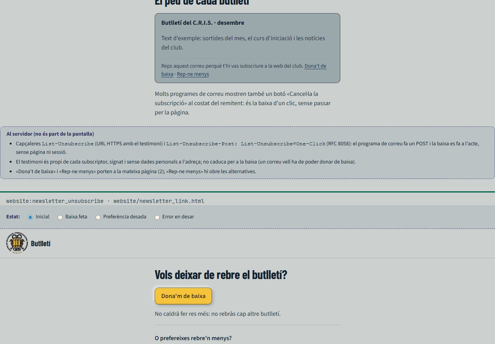
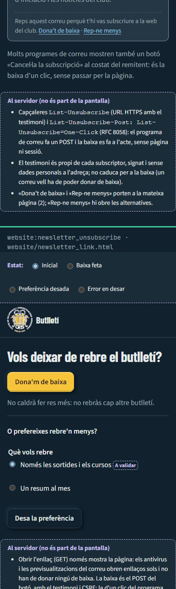

# T-M07-33 · Wireframe de la baixa del butlletí d'un clic amb alternatives

| Data i hora (Europa/Madrid) | Commit | Proves | CI |
|---|---|---|---|
| 28/11/2026 00:26 | 14cf62bd | 2 noves, 1 e2e nova | [A comprovar] |

**En tres línies:** el pilot va demanar el wireframe abans de construir la T-M07-33 (resposta del propietari del 27/11, decisió 108). La baixa total es fa amb un sol clic, des del programa de correu o amb el primer botó de la pàgina; les alternatives («només sortides», «un resum al mes») van plegades a sota i no fan falta per a res. Cap missatge no diu si una adreça és a la llista.

## Què s'ha fet
- `design/wireframes/butlleti-baixa.html`, amb quatre pantalles:
  - **El peu del correu:** «Dona't de baixa» i «Rep-ne menys», i la baixa d'un clic del programa de correu (`List-Unsubscribe-Post`, RFC 8058).
  - **La pàgina de baixa:** «Dona'm de baixa» com a únic botó principal, les alternatives plegades a sota, i els estats de baixa feta, preferència desada i error.
  - **L'enllaç no vàlid:** demana l'adreça i respon sempre «Si aquesta adreça rep el butlletí, t'hi hem enviat un enllaç».
  - **Al compte del soci:** la mateixa baixa i les mateixes alternatives, sense cap botó principal, i l'estat de sessió caducada.
- Proves: `apps/core/tests/test_wireframes_butlleti_baixa.py` (notes «Al servidor» a totes les pantalles; la baixa és el primer botó i l'únic principal; les alternatives, plegades; cap `style=` ni color escrit a mà) i l'e2e que l'obre des del disc i en fa les captures, al mapa del hook.
- P-428 a `docs/decisions/pendents.md` i al tauler: quines alternatives hi ha.

## Decisions i perquè
- **Obrir l'enllaç no dona de baixa** (avui sí): els antivirus i les previsualitzacions del correu obren els enllaços sols. La baixa és el POST del botó, o el POST d'un clic del programa de correu.
- **«Torna'm a subscriure» envia un correu de confirmació**: tornar-hi és una alta i necessita la doble confirmació.
- **La baixa del butlletí no toca els correus de servei** (quotes, pagaments, inscripcions), i la pàgina del soci ho diu.
- **Alternatives com a llista d'ajustos:** el butlletí avui és un de sol, i partir-lo per temes no és a cap regla (P-428, configurable, opció per defecte A).

## Com se sap que funciona
- Passen les dues proves noves i l'e2e (sense connexió, sense errors de consola ni desplaçament de costat a 320 px).

## Comprovació §15.5
- **B:** cap animació; objectius de 44 px; el plegable s'obre amb el teclat.
- **D:** un sol botó principal a la pàgina de baixa i cap a la del soci; títols concrets («Vols deixar de rebre el butlletí?»).
- **Tokens:** cap color ni mida fora de `tokens.css`; cap `style=`.
- **Captures mirades** a 1280, 1024, 390 i 320 px, en clar i en fosc.

## Queda
- El pilot construeix la T-M07-33 a partir del wireframe; la revisaré quan sigui a master.

## Evidències
- La pàgina de baixa a 1280 px. `captures/2026-11-28_0026_T-M07-33_baixa-1280.png`

  

  *28/11/2026 00:26 (Europa/Madrid) · local, prova e2e, dades inventades · commit 14cf62bd*

- A 390 px, en fosc. `captures/2026-11-28_0026_T-M07-33_baixa-390-fosc.png`

  

  *28/11/2026 00:26 (Europa/Madrid) · local, prova e2e, dades inventades · commit 14cf62bd*
