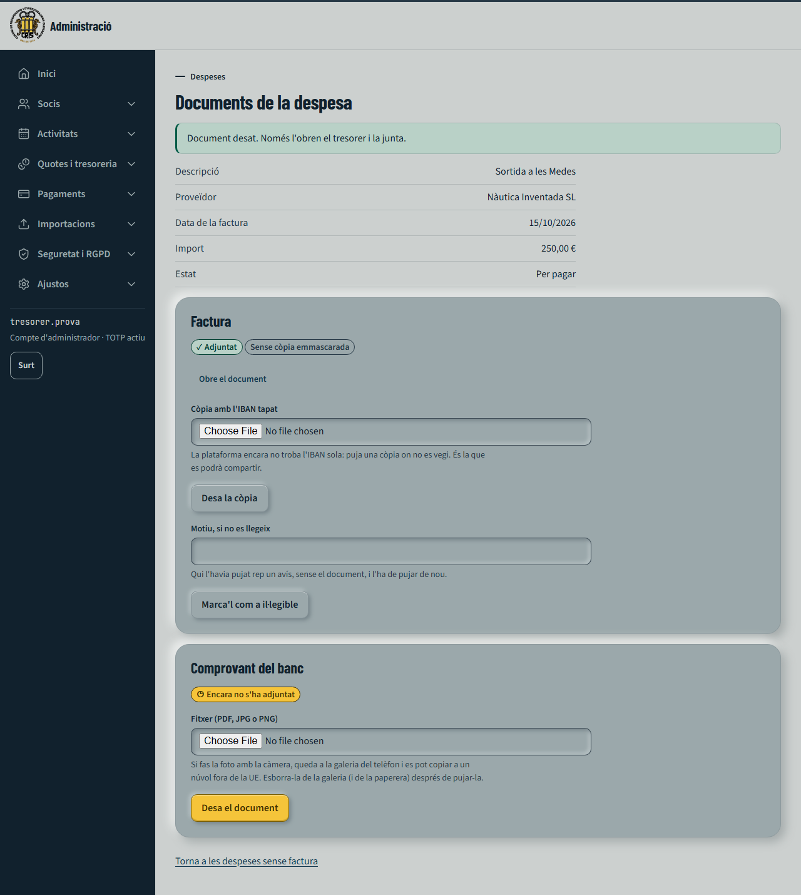
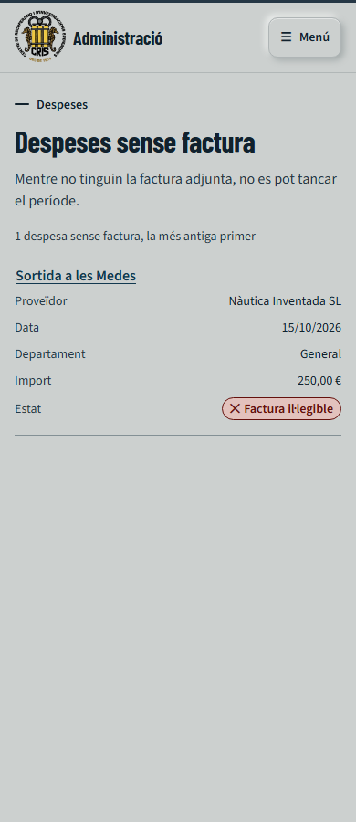

# T-M09-04b · Documents d'una despesa: factura, comprovant i il·legible (amb la T-M09-05 i la T-M09-15)

| Data i hora (Europa/Madrid) | Commit | Proves | CI |
|---|---|---|---|
| 24/11/2026 14:25 | 77468e2b | 9 noves i 1 e2e | [A comprovar] |

**En tres línies:** cada despesa té ara una pantalla «Documents de la despesa». Qui la registra hi adjunta la factura i el tresorer hi adjunta el comprovant del banc. Els dos fitxers es desen xifrats i només els obren el tresorer i la junta. Si un document no es llegeix, el tresorer el marca amb un motiu: la despesa torna a «Despeses sense factura», amb l'estat «Factura il·legible», fins que algú en puja un de nou.

## Què s'ha fet
- `apps/expenses/views.py`: `documents_view`, a la ruta `/gestio/despeses/<id>/documents/`, que mostra la despesa i els dos documents.
- `templates/expenses/documents.html`, amb només components existents. A «Despeses sense factura», la descripció de cada despesa hi enllaça i una factura il·legible ho diu.
- Proves noves a `apps/expenses/tests/test_documents_views.py` i una e2e a `apps/core/tests/e2e/test_despeses.py`.
- `docs/estat/M09.md`: la T-M09-04b, la T-M09-05, la T-M09-06 i la T-M09-15. Detall: [tasques del 09](../planning.md#M09-10-tasques).

## Decisions i perquè
- **Una sola pantalla per als dos documents:** pujar, marcar com a il·legible i la còpia emmascarada són de la mateixa despesa. Tots els serveis ja existien (T-M09-25b).
- **Qui veu què:** la factura la puja MG1 i el comprovant, MG2. Marcar un document i pujar la còpia emmascarada demanen MG2 i C5. L'enllaç «Obre el document» només surt amb C5, però el control és la vista `private_file`, que desxifra el fitxer i deixa l'obertura al registre. Qui puja la factura sense C5 (el President) no la pot tornar a obrir.
- **Text d'ajuda de RN-M09-25 a cada pujada:** és la mitigació d'un risc i es queda al codi (VC-35 no s'aplica).
- **Sense vista prèvia:** RN-M09-25 la demana al navegador abans de desar, i no hi ha cap component del sistema de disseny que la faci. És de la T-M09-06 i l'ha de fer DISSENY.

## Com se sap que funciona
- El President adjunta la factura, la despesa surt de «sense factura» i ell no veu l'enllaç per obrir-la.
- El tresorer adjunta el comprovant i la còpia emmascarada, i obre la factura desxifrada.
- Una factura marcada il·legible torna a la llista. El nou document tanca la marca.
- Errors sense canvis: cap fitxer, un tipus no permès, un document que ja hi és, una despesa anul·lada.
- Sense MG1 ni MG2, o amb l'abast «les seves activitats», «no trobat».

## Evidències
- Documents d'una despesa a 1280 px, amb la factura adjuntada. `captures/2026-11-24_1425_T-M09-04b_documents-1280.png`

  

  *24/11/2026 14:25 (Europa/Madrid) · local, prova e2e, dades inventades · commit 77468e2b*
- «Despeses sense factura» a 390 px, amb una factura il·legible. `captures/2026-11-24_1425_T-M09-04b_sense-factura-illegible-390.png`

  

  *24/11/2026 14:25 (Europa/Madrid) · local, prova e2e, dades inventades · commit 77468e2b*
- Sortida de proves · commit 77468e2b · executada el 24/11/2026 en local (PostgreSQL 16):
  ```
  $ pytest -q apps/expenses
  135 passed
  $ pytest -m e2e apps/core/tests/e2e/test_despeses.py
  2 passed
  ```
