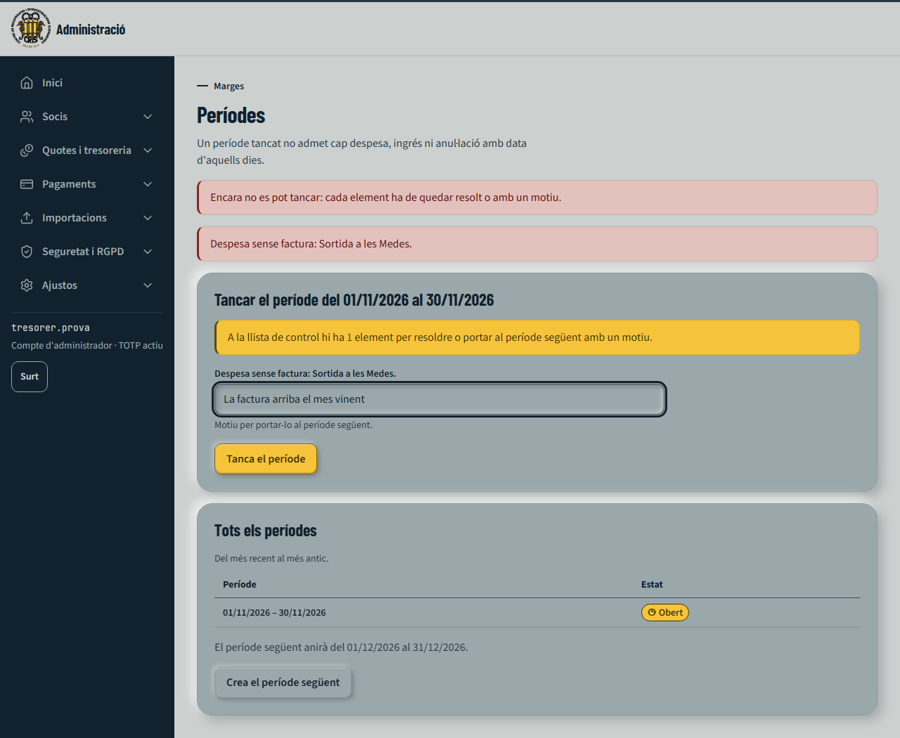
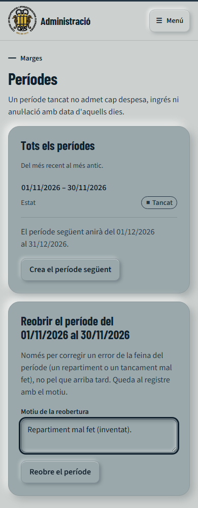

# T-M09-16c · Pantalla dels períodes i creació del període següent

| Data i hora (Europa/Madrid) | Commit | Proves | CI |
|---|---|---|---|
| 23/11/2026 14:45 | (vegeu la PR) | 11 noves; 1 e2e | [A comprovar] |

**En tres línies:** el tresorer ja pot portar els períodes del 09 des de la plataforma: crear el següent, veure la llista de control del primer període obert i tancar-lo, resolent cada element o portant-lo al període següent amb un motiu. L'administració pot reobrir el darrer període tancat amb un motiu. La durada dels períodes nous és un ajust (mensual d'inici).

## Què s'ha fet
- `apps/margins/period_closing.py`: `next_dates` i `create_next` (MG11; RN-M09-28): el període nou comença l'endemà del darrer i dura el que diu `margin.period_length` (VC-32, `margins/0006`) en aquell moment; el primer comença el dia que tria el tresorer.
- `apps/margins/views.py`, `admin_urls.py` i `templates/margins/periods.html`: `/gestio/marges/periodes/` amb els formularis de crear, tancar (un motiu per element) i reobrir.
- La prova al navegador, al mapa del hook (`.claude/hooks/e2e_map.py`).

## Decisions i perquè
- El camp del motiu porta la clau estable de l'element (no la posició): si la llista canvia entre que es mostra i que s'envia, un motiu no passa a un altre element.
- No es crea cap període mentre el darrer encara no ha començat, perquè no s'apilin períodes futurs que no es poden esborrar.
- L'entrada de menú «Períodes» és a la branca del nucli `nucli/T-M09-16c-menu`; fins llavors s'hi arriba per l'adreça.

## Problemes trobats
Cap.

## Com se sap que funciona
`apps/margins/tests/test_period_create.py` (primer període i següents, CA-M09-35 a nivell de servei, cap període futur apilat, sumar mesos, permisos, i la pantalla: tancar amb un motiu per element, crear el primer, només l'administració reobre) i `apps/core/tests/e2e/test_periodes.py` (captures a 1280, 390 i 320 px, mirades).

## Captures

## Termes nous
Cap.
