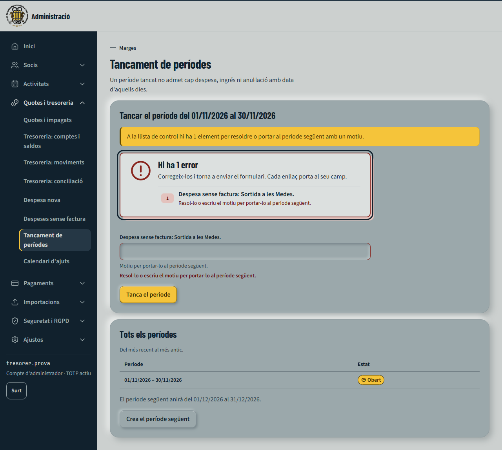
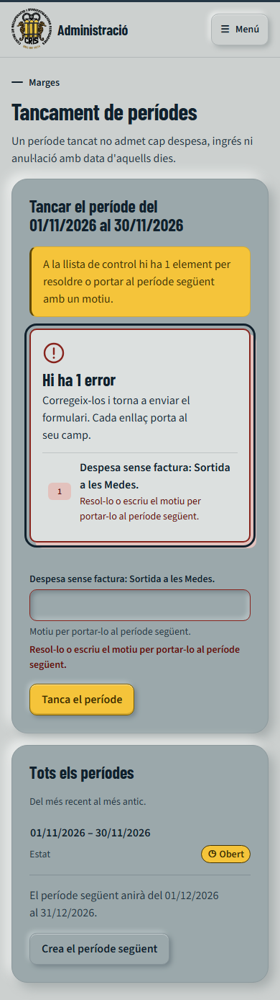

# T-M09-16d · Errors del tancament d'un període amb Errata

| Data i hora (Europa/Madrid) | Commit | Proves | CI |
|---|---|---|---|
| 23/11/2026 19:05 | (vegeu la PR) | 1 ampliada; 1 e2e ampliada | [A comprovar] |

**En tres línies:** quan el tresorer intenta tancar un període i falta resoldre algun element, la pàgina ja no posa missatges a dalt que repeteixen l'element. Ara surt el resum d'errors Errata, amb un enllaç a cada camp, i l'error a sota del camp de l'element. És una correcció de DISSENY.

## Què s'ha fet
- `apps/margins/views.py`: el tancament que no es pot fer torna la pàgina amb el formulari i els errors (`add_error` al camp de cada element, o general si és un altre error), en lloc de redirigir amb `messages.error`.
- `templates/margins/periods.html`: `_errata.html` dins del formulari de tancament (design-system §6.10).

## Decisions i perquè
- Si el formulari que torna no és el del període que es tanca ara (per exemple, una altra persona ja l'ha tancat), l'error surt com a missatge a dalt, perquè el camp ja no hi és.

## Problemes trobats
Cap.

## Com se sap que funciona
`apps/margins/tests/test_period_create.py::test_la_pantalla_tanca_amb_un_motiu_per_element` (primer va fallar: 302 en lloc de 200) i `apps/core/tests/e2e/test_periodes.py` (captures a 1280 i 390 px, mirades).

## Captures

## Termes nous
Cap.
