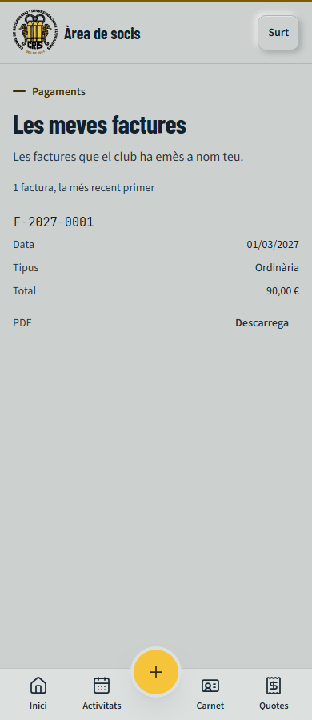

# T-M09-21b · Descarregar el PDF a «Les meves factures»

| Data i hora (Europa/Madrid) | Commit | Proves | CI |
|---|---|---|---|
| 24/11/2026 16:00 | 1fa10d6a | 1 nova i 1 e2e ampliada | [A comprovar] |

**En tres línies:** a «Les meves factures», cada factura que ja té el PDF porta ara «Descarrega». El soci se la baixa des del seu compte personal; la d'una altra persona, encara que en sàpiga l'adreça, dona «no trobat».

## Què s'ha fet
- `templates/invoicing/mine.html`: columna «PDF», amb «Descarrega» (enllaç a la vista `private_file` de la 00) o «Encara no disponible».
- Prova nova a `apps/invoicing/tests/test_views.py` i la e2e `test_meves_factures.py`, ampliada.
- `docs/estat/M09.md`: la T-M09-21 passa a «feta». Detall: [tasques del 09](../planning.md#M09-10-tasques).

## Decisions i perquè
- **Cap vista nova:** la de la 00 ja comprova que el fitxer sigui de la persona del compte, el desxifra i deixa l'obertura al registre. La plantilla només hi enllaça; amagar l'enllaç no és cap control.
- **L'enllaç diu quina factura és** (`aria-label`), per al lector de pantalla quan n'hi ha diverses.

## Com se sap que funciona
- El soci baixa el PDF de la seva factura, desxifrat i com a descàrrega. El d'una altra persona dona «no trobat». Una factura sense PDF diu «Encara no disponible».

## Evidències
- «Les meves factures» a 390 px. `captures/2026-11-24_1600_T-M09-21b_meves-factures-390.png`

  

  *24/11/2026 16:00 (Europa/Madrid) · local, prova e2e, dades inventades · commit 1fa10d6a*
- Sortida de proves · commit 1fa10d6a · executada el 24/11/2026 en local (PostgreSQL 16):
  ```
  $ pytest -q apps/invoicing
  41 passed
  $ pytest -m e2e apps/core/tests/e2e/test_meves_factures.py
  1 passed
  ```
