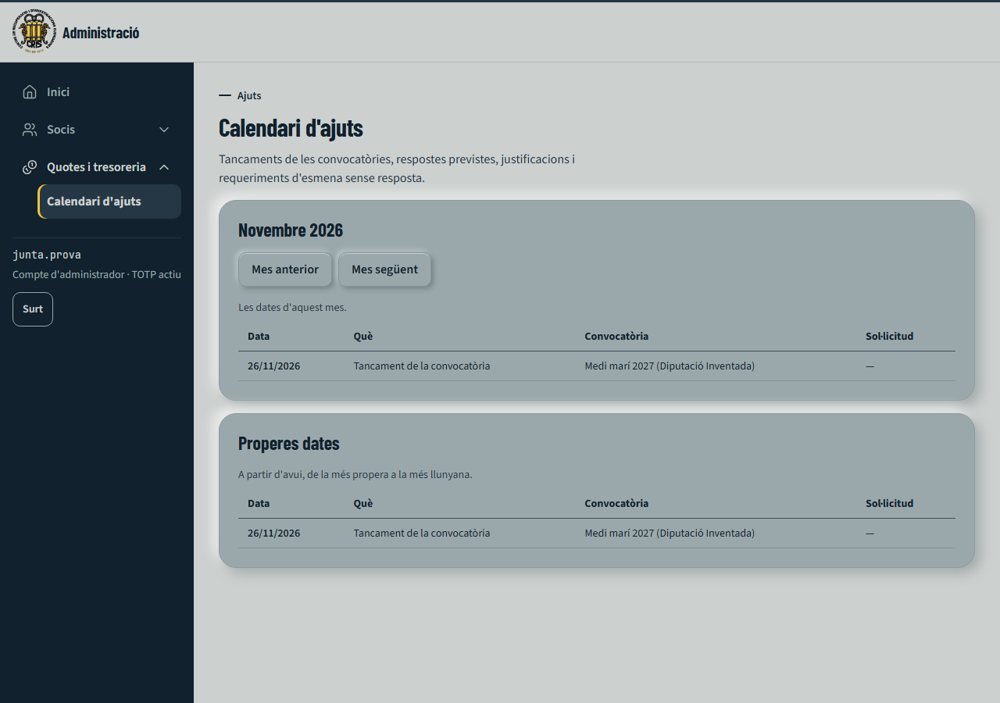
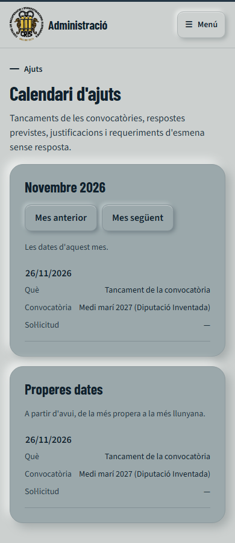

# T-M09A-05 · Calendari d'ajuts

| Data i hora (Europa/Madrid) | Commit | Proves | CI |
|---|---|---|---|
| 23/11/2026 14:57 | (vegeu la PR) | 4 noves; 1 e2e | [A comprovar] |

**En tres línies:** el tresorer, la junta i l'administració tenen una pantalla amb totes les dates dels ajuts: tancaments de convocatòries, respostes previstes, justificacions i requeriments d'esmena sense resposta. Es pot anar de mes en mes i, a sota, hi ha totes les dates a partir d'avui. Només es mira; no es canvia res.

## Què s'ha fet
- `apps/grants/calendar.py` (`calendar(from, to)`, el servei de M09-ajuts-8), `apps/grants/views.py`, `apps/grants/admin_urls.py` i `templates/grants/calendar.html` i `_events.html`: `/gestio/ajuts/calendari/` amb AJ3.
- Commit «(nucli)»: la ruta inclosa a `apps/accounts/admin_urls.py` i l'entrada «Calendari d'ajuts» al menú (grup «Quotes i tresoreria»; el lloc, per revisar amb DISSENY).

## Decisions i perquè
- La justificació fa servir la pròrroga si n'hi ha (RN-M09A-20); un requeriment respost ja no hi surt.
- Cap dada personal: ni el responsable ni la descripció del requeriment; només la convocatòria, l'organisme, la referència i l'estat.
- «Properes dates» no té límit de dies, per no escriure cap termini al codi.
- Canviar de mes són enllaços normals (usable amb teclat, B8).

## Problemes trobats
Cap.

## Com se sap que funciona
`apps/grants/tests/test_calendar.py` (tancament i resposta prevista, justificació amb pròrroga, requeriments oberts, la pantalla i «no trobat» sense AJ3) i `apps/core/tests/e2e/test_calendari_ajuts.py` (captures a 1280, 390 i 320 px, mirades).

## Captures

## Termes nous
Cap.
