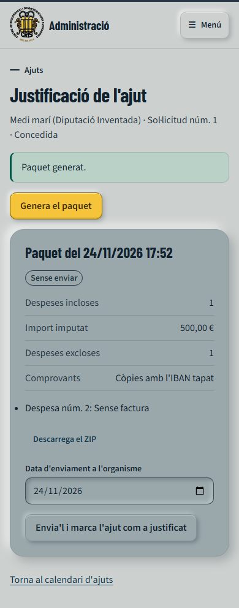
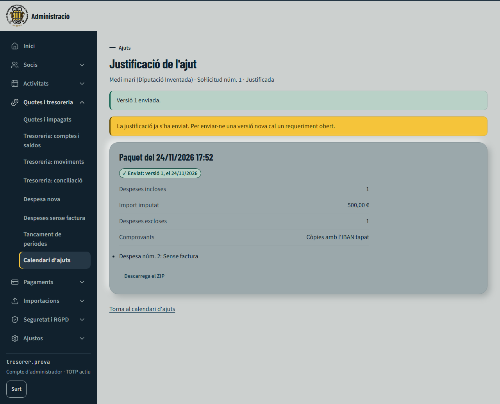

# T-M09A-10c · Pantalla «Justificació de l'ajut»

| Data i hora (Europa/Madrid) | Commit | Proves | CI |
|---|---|---|---|
| 24/11/2026 17:54 | 97427b29 | 8 noves i 1 e2e | [A comprovar] |

**En tres línies:** el tresorer ja pot justificar un ajut des de la plataforma. Genera el paquet, hi veu quines despeses n'han quedat fora i per què, en descarrega el ZIP i l'envia: l'ajut queda «justificat». Si després arriba un requeriment, la mateixa pantalla en prepara i n'envia una versió nova.

## Què s'ha fet
- `apps/grants/views.py`: `justification_view`, a la ruta `/gestio/ajuts/<id>/justificacio/`. El calendari d'ajuts hi enllaça les sol·licituds concedides i les justificades, si qui el mira té AJ7.
- `templates/grants/justification.html`, amb només components existents.
- Commit «(nucli)»: la pantalla penja del «Calendari d'ajuts» al menú (`apps/accounts/navigation.py`).
- Proves noves a `apps/grants/tests/test_justification_views.py` i la e2e `test_justificacio_ajut.py`.
- `docs/estat/M09.md`: la T-M09A-10 passa a «feta». Detall: [tasques del 09](../planning.md#M09-10-tasques).

## Decisions i perquè
- **Qui veu què:**
  - la pantalla, AJ7 (la junta, de consulta);
  - generar el paquet, AJ7 amb «Sí» i AJ12;
  - descarregar-lo, la vista `private_file`, que demana AJ12, desxifra el ZIP i deixa l'obertura al registre.
  Amagar un botó no és cap control: els serveis ho tornen a comprovar.
- **Una versió nova sempre tria el requeriment obert que respon:** RN-M09A-21.
- **Les despeses surten pel número i el motiu:** cap dada personal.

## Com se sap que funciona
- CA-M09A-08: es genera el paquet, s'hi veuen el total i la despesa exclosa, el ZIP es descarrega i s'envia la versió 1, que justifica l'ajut.
- CA-M09A-20: amb un requeriment obert, s'envia la versió 2 i el requeriment queda respost.
- CA-M09A-15: la pantalla diu quan el paquet porta els originals.
- Errors amb el missatge (data buida, paquet ja enviat) i peticions errònies, «no trobat». La junta veu la pantalla però no genera. Sense AJ7, «no trobat».

## Evidències
- Justificació a 390 px, amb el paquet generat. `captures/2026-11-24_1755_T-M09A-10c_justificacio-390.png`

  

  *24/11/2026 17:55 (Europa/Madrid) · local, prova e2e, dades inventades · commit 97427b29*
- Justificació a 1280 px, un cop enviada. `captures/2026-11-24_1755_T-M09A-10c_justificacio-enviada-1280.png`

  

  *24/11/2026 17:55 (Europa/Madrid) · local, prova e2e, dades inventades · commit 97427b29*
- Sortida de proves · commit 97427b29 · executada el 24/11/2026 en local (PostgreSQL 16):
  ```
  $ pytest -q apps/grants apps/accounts/tests/test_navigation_subpages.py
  167 passed
  $ pytest -m e2e apps/core/tests/e2e/test_justificacio_ajut.py apps/core/tests/e2e/test_calendari_ajuts.py
  2 passed
  ```
